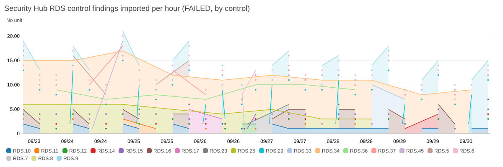
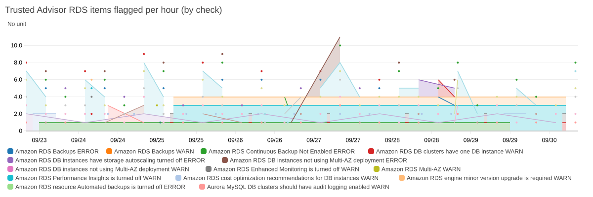
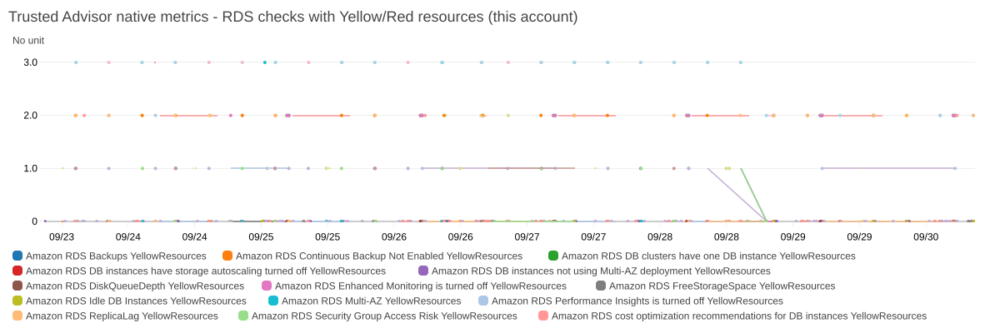
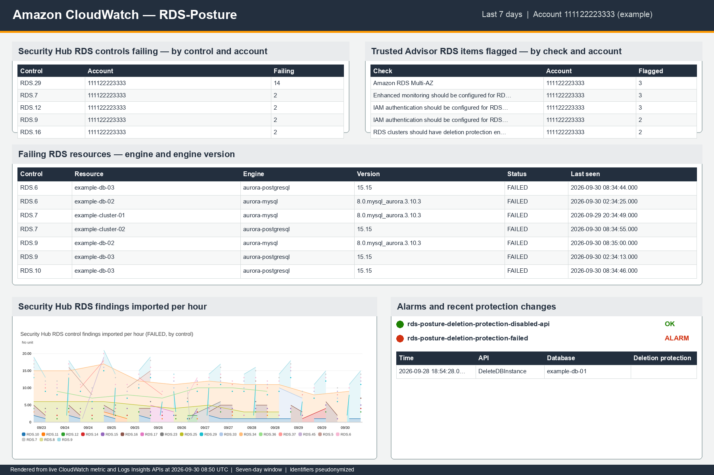

# Dashboard captures

Captured 2026-09-30 08:50 UTC, last 168.0 h (7 days). Account IDs, IAM identities, IP addresses and RDS resource names are replaced with documentation values.

## Security Hub RDS controls FAILING (latest state per resource) - by control and account

See [security-hub-rds-controls-failing-latest-state-per-resource-.md](security-hub-rds-controls-failing-latest-state-per-resource-.md) (13 rows).

## Trusted Advisor RDS items flagged WARN/ERROR (latest state per resource) - by check and account

See [trusted-advisor-rds-items-flagged-warn-error-latest-state-pe.md](trusted-advisor-rds-items-flagged-warn-error-latest-state-pe.md) (20 rows).

## Failing RDS resources - Security Hub detail (latest state per resource and control)

See [failing-rds-resources-security-hub-detail-latest-state-per-r.md](failing-rds-resources-security-hub-detail-latest-state-per-r.md) (33 rows).

## Flagged RDS resources - Trusted Advisor detail (latest state per resource and check)

See [flagged-rds-resources-trusted-advisor-detail-latest-state-pe.md](flagged-rds-resources-trusted-advisor-detail-latest-state-pe.md) (29 rows).

## Security Hub RDS control findings imported per hour (FAILED, by control)

## Trusted Advisor RDS items flagged per hour (by check)

## Trusted Advisor native metrics - RDS checks with Yellow/Red resources (this account)

## Who changed RDS protection posture - deletion protection switched off, created unprotected, deleted (CloudTrail via EventBridge)

See [who-changed-rds-protection-posture-deletion-protection-switc.md](who-changed-rds-protection-posture-deletion-protection-switc.md) (1 rows).

## AWS Config compliance changes on RDS resources (recent)

See [aws-config-compliance-changes-on-rds-resources-recent.md](aws-config-compliance-changes-on-rds-resources-recent.md) (0 rows).

## AWS Health RDS events - planned lifecycle / end of standard support / scheduled changes

See [aws-health-rds-events-planned-lifecycle-end-of-standard-supp.md](aws-health-rds-events-planned-lifecycle-end-of-standard-supp.md) (1 rows).

## Publication composite

